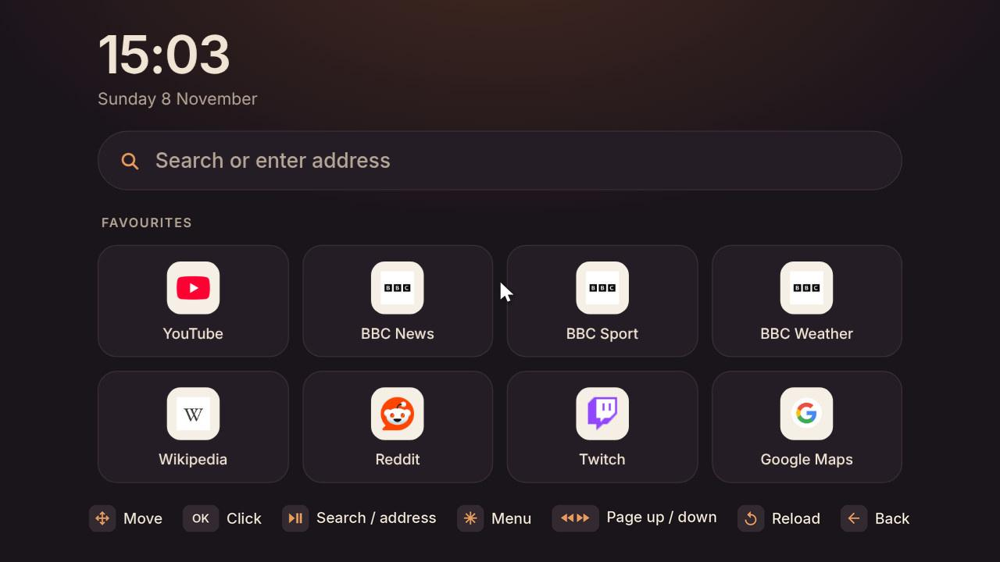
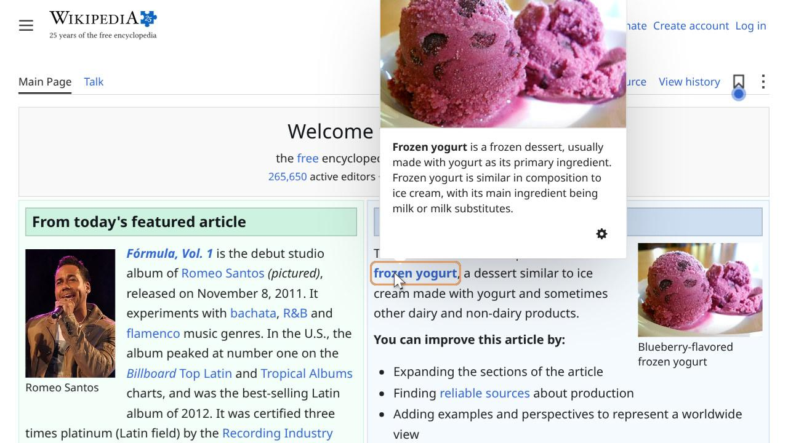
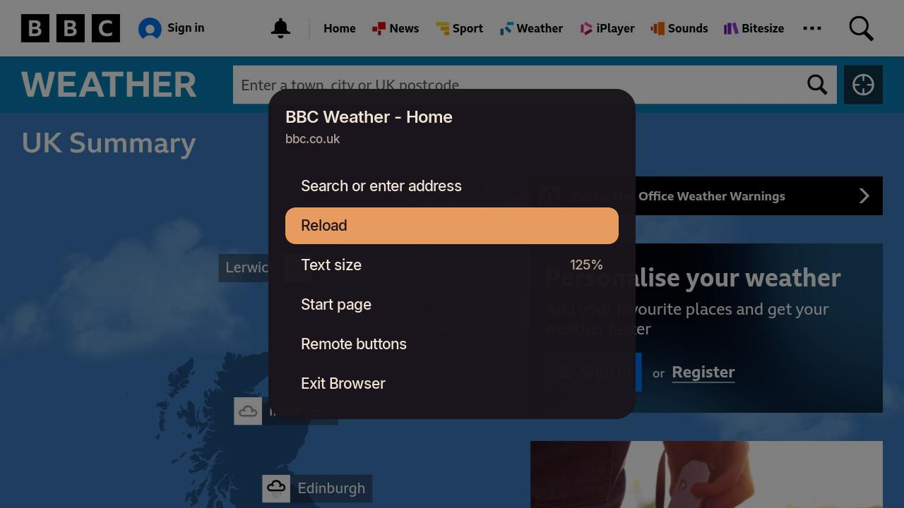
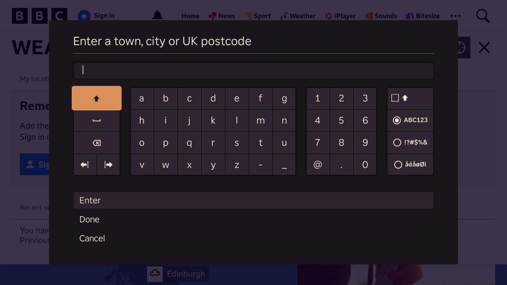

# Browser for Roku

A real web browser on your Roku TV or stick, driven by the Roku remote.

Roku devices can't run a browser engine: apps are BrightScript only, with no web view
and no native code. So this project splits the job:

- **On your Linux laptop**, a small service (`roku-browser`) runs a hidden Brave/Chromium,
  renders pages at the TV's resolution, and streams them as sharp JPEG frames.
- **On the Roku**, the *Browser* app shows those frames and turns the remote into a
  mouse. The cursor is drawn on the Roku itself, so it moves instantly, and it highlights
  links and buttons as you pass over them. Clicks, scrolling and typing go back to the laptop.
- **Videos play natively**: anything with a direct stream (HLS, DASH, MP4) plays in the
  Roku's own player with sound, and YouTube links open the YouTube app.

Everything stays on your home network; nothing goes through a third-party server.

| | |
|---|---|
|  |  |
|  |  |

## What you need

- A Roku player or Roku TV on current software (developed on a Roku Streaming Stick, Roku OS 15).
- A Linux laptop or desktop with systemd, on **the same Wi-Fi** as the Roku. Some guest
  networks stop devices from seeing each other; use one that doesn't.
- On the laptop: Python 3.9+, `aiohttp`, Pillow, `curl`, and Brave, Chromium or Google Chrome.

The laptop does the browsing, so it needs to be awake while you use the Browser app.

## Setup from scratch

### 1. Set up the Roku

Plug it in, connect it to your Wi-Fi and finish Roku's own setup (it asks you to sign in to
a Roku account). Use the same Wi-Fi network as your laptop.

### 2. Let the laptop control the Roku

On the Roku: **Settings → System → Advanced system settings → Control by mobile apps →
Network access → Enabled**.

This is the same setting the official Roku phone app needs. *Limited* isn't enough.

### 3. Turn on developer mode

This lets you install your own apps on the Roku. It's free and built in.

1. On the Roku remote press **Home ×3, Up ×2, Right, Left, Right, Left, Right**.
2. The *Developer settings* screen opens. Note the IP address it shows.
3. Choose **Enable installer and restart**, accept the agreement, and **set a password**.
   That's the developer password. The username is always `rokudev`.
4. The Roku restarts.

### 4. Install on the laptop

Install the requirements:

```sh
# Arch
sudo pacman -S git python python-aiohttp python-pillow curl chromium
# Debian / Ubuntu
sudo apt install git python3 python3-aiohttp python3-pil curl chromium
# Fedora
sudo dnf install git python3 python3-aiohttp python3-pillow curl chromium
```

(If Brave or Google Chrome is already installed, you can skip `chromium`. On **Ubuntu**,
`chromium` comes as a snap, and snaps can't use the hidden folder the browser profile lives in.
Install [Google Chrome](https://www.google.com/chrome/) or [Brave](https://brave.com/linux/)
from their own packages instead.)

Then:

```sh
git clone https://github.com/B-Divyesh/roku-browser.git
cd roku-browser
./install.sh
```

The installer:

1. checks the requirements,
2. finds your Roku on the network (or use `ROKU_IP=… ./install.sh`),
3. checks the two Roku settings above and asks for the developer password,
4. installs the service to `~/.local/share/roku-browser/app` and starts it with your login,
5. installs the *Browser* app on the Roku and opens it,
6. waits until the TV has connected.

If a firewall is running, it tells you which ports to open (8765/tcp and 8766/udp).

A successful run looks like this:

```
==> Checking this laptop
    python3, aiohttp, pillow, curl and brave are all here.
==> Looking for Rokus on this network
    Living room (Streaming Stick, Roku OS 15.3.4) at 192.168.1.50
    Developer mode is on and the password works; saved to ~/.config/roku/config.json (only you can read it).
==> Installing roku-browser to ~/.local/share/roku-browser/app
    Service running and starting with your login.
==> Installing the Browser app on the Roku
    Application Received: 421180 bytes stored.
    Install Success.
==> Waiting for the TV to connect
    Connected. The Browser app is showing on your TV.
```

If it can't find the Roku, look up its address on the Roku under **Settings → Network → About**
and run `ROKU_IP=that.address ./install.sh`. The `roku` command is installed to `~/.local/bin`;
most distributions already have that on your `PATH`.

After this, the *Browser* app is on the Roku home screen. You can delete the cloned folder;
run `./install.sh` again from a fresh clone to update.

## Using it

| Remote button | Does |
|---|---|
| Arrows | Move the cursor (hold to speed up). Links and buttons light up under it; push past an edge to scroll |
| OK | Click. Clicking a text box opens the keyboard |
| Play/Pause | Search or type an address |
| ✱ (Options) | Menu: search, play the page's video on the TV, forward, reload, text size, start page, exit |
| Rewind / Fast-forward | Page up / page down |
| Instant replay ↺ | Reload |
| Back | Go back; press twice on the first page to exit |

The cursor fades out when you stop using the remote; any button brings it back.

From the laptop:

```sh
roku open bbc.co.uk            # show a page on the TV (or a search: roku open "weather leeds")
roku play ~/Videos/film.mkv    # play a file from the laptop on the TV
roku play https://…/video.m3u8 # play a stream in the Roku's own player
roku play https://youtu.be/…   # opens the YouTube app on that video
roku                           # use this keyboard as a remote (arrows, Enter, Backspace, / to type)
roku type "some text"          # type into the page, or into any Roku on-screen keyboard
roku launch netflix            # open any installed app by name
roku now                       # what's on screen and what's playing
roku shot                      # screenshot of the Browser app
```

Optional: install `yt-dlp` and the menu's *Find video on this page* can play videos from
most video sites in the Roku's player.

## Troubleshooting

- **The TV says "Looking for your laptop".** The laptop must be awake, on the same network,
  and running the service: `systemctl --user status roku-browser`. If a firewall is on, open
  8765/tcp and 8766/udp.
- **"The Roku refused that"** from `roku`: set *Control by mobile apps* to *Enabled* (step 2).
- **Google asks you to prove you're human.** Google often flags browsers it can't see
  directly. Searches use Brave Search by default, which doesn't. To change the search
  engine or start page, add `"search": "https://duckduckgo.com/?q={}"` or
  `"home": "https://…"` to `~/.config/roku/config.json` and restart the service.
- **Netflix, iPlayer, Prime Video** use DRM and won't play inside the browser. Use their
  Roku apps (`roku launch iplayer`).
- **The Browser app disappeared.** Turning developer mode off removes it. Turn it back on
  and run `./install.sh` again. Developer mode allows one sideloaded app at a time.
- Logs: `journalctl --user -u roku-browser -f` on the laptop, `roku console` for the Roku app.

## Privacy and security

- `~/.config/roku/config.json` (mode 600) holds the Roku's address and your developer
  password. It never leaves the laptop and isn't part of this repository.
- The hidden browser keeps its own profile, with its own cookies and logins, in
  `~/.local/share/roku-browser/profile`, separate from your normal browser.
- The service only answers this laptop and Roku devices. Before serving any other address
  on the network, it checks that the address really is a Roku.
- The hidden browser closes after 15 minutes without use.

## Uninstall

```sh
./uninstall.sh            # removes the service, the browser profile and the Roku app
./uninstall.sh --forget   # also forgets the Roku address and developer password
```

## How it's built

```
server/roku_browser.py   laptop service: headless browser over the DevTools protocol, frame
                         capture (PNG → 4:4:4 JPEG), click targets, input, video hand-off,
                         UDP discovery, HTTP API for the Roku app and the roku command
channel/                 the Roku app (SceneGraph + BrightScript)
  components/BrowserScene  page frames (double-buffered), cursor, highlights, menu, keyboard, video
  components/PollTask      long-polls the laptop for new frames; finds it by broadcast
  components/CmdTask       sends clicks, scrolls and typing in order
  art/make_art.py          draws the icons, cursor and panels, and subsets the fonts
bin/roku                 command-line remote, casting and developer tools
install.sh, uninstall.sh
```

Working on the Roku app: edit `channel/`, then `roku sideload` installs it and
`roku console` shows its debug output. `make_art.py` needs Pillow, fontTools, Inter and
Symbols Nerd Font.

## Credits

- [Inter](https://rsms.me/inter/) by Rasmus Andersson, SIL Open Font License 1.1
  (`channel/fonts/OFL.txt`).
- Icons in the hint bar and app icon are from [Material Design Icons](https://pictogrammers.com/library/mdi/)
  (Apache 2.0), via Nerd Fonts.
