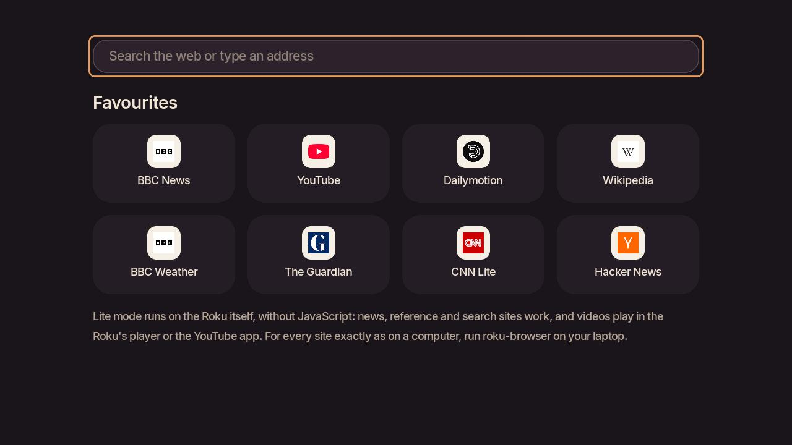
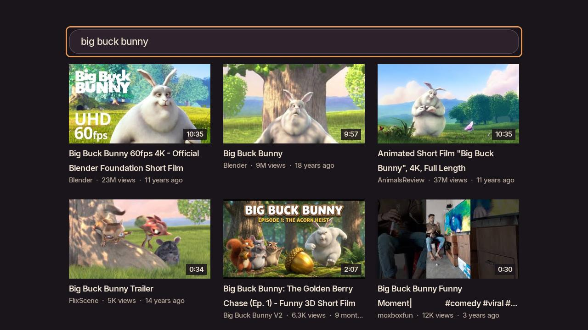
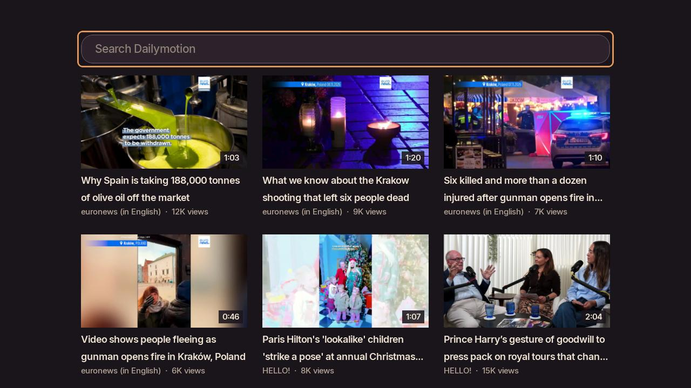

# Browser for Roku

A web browser for your Roku TV or stick, driven by the Roku remote. It works two ways:

- **Full browser, with your Linux laptop.** A small service on the laptop (`roku-browser`)
  runs a hidden Brave/Chromium, renders pages at the TV's resolution and streams them as
  sharp frames. On the TV, the remote becomes a mouse: the cursor is drawn on the Roku, so it
  moves instantly, and links light up as you pass over them. Every site works, as on a computer.
  Only what changed on screen is sent, and scrolling moves the picture on the TV at once.
  Press play on a video in a page and it moves to the Roku's own player, smooth and with sound.
- **Lite mode, laid out by the Roku itself.** Pages come as text, links, pictures and search
  boxes laid out natively, and the remote moves between the things you can click. While the
  laptop is reachable, its browser runs each page (JavaScript and all) and hands the Roku the
  finished layout, so nearly every site works and pages appear in a fraction of a second.
  Without the laptop, the Roku reads pages itself: sites that need JavaScript can't run then,
  but news, reference, search and plenty more work. YouTube and Dailymotion get native pages
  built from their own data services either way.

The app picks for you: full browser when the laptop answers, Lite mode after a few seconds
if it doesn't, and you can switch from the menu at any time.

| | Full browser (laptop) | Lite mode (Roku alone) |
|---|---|---|
| Websites | Every site, as on a computer | With the laptop on: nearly every site, laid out for reading. Alone: sites that work without JavaScript (news, Wikipedia, search, forums, blogs) |
| YouTube | Browse youtube.com; videos open in the YouTube app | Search and results on the TV; videos open in the YouTube app |
| Dailymotion | Plays on the TV with sound | Trending and search on the TV; plays with sound while the laptop is on, picture only without it |
| Other videos | Press play and the video moves to the Roku's own player, with sound | `<video>` tags, embedded players and video links play in the Roku's own player |
| Search | Brave Search, or your choice from the top bar | DuckDuckGo |

Everything stays on your home network; nothing goes through a third-party server.

**Full browser**

| | |
|---|---|
|  |  |
|  |  |

**Lite mode**

| | |
|---|---|
|  |  |
|  |  |

## What you need

- A Roku player or Roku TV with Roku OS 10 or newer (see step 1).
- For the full browser: a Linux laptop or desktop with systemd, on **the same Wi-Fi** as the
  Roku, with Python 3.9+, `aiohttp`, Pillow, `curl`, and Brave, Chromium or Google Chrome.
  It does the browsing, so it needs to be awake while you use the full browser. Some guest
  networks stop devices from seeing each other; use one that doesn't. Optional: `ffmpeg`,
  for Dailymotion with sound.
- **Lite mode only?** No laptop needed: do steps 1 to 4 below, then
  [install the app by hand](#installing-the-roku-app-by-hand-optional) from any computer's web
  browser (Windows, Mac, Linux or a phone).

## Setup from scratch

There are two parts. First the Roku needs one setting changed and developer mode switched
on (steps 1 to 4, all done with the remote). Then a single command on the laptop installs
everything else (step 5).

### 1. Check your Roku

Any current Roku works: Roku Express, Streaming Stick and Ultra players, and TVs with Roku
built in (Roku, TCL, Hisense, Sharp and others). It needs **Roku OS 10 or newer**.

To check, open **Settings → System → About** on the Roku. It shows the model (for example
*Roku Streaming Stick, 3840EU*) and the *Software version* (for example *15.3.4*). If the
software is older than 10, update it: **Settings → System → System update → Check now**.

This was developed and tested on a Roku Streaming Stick 3840EU running Roku OS 15.3.4. That
stick draws its interface at 720p, so pages are sent at 1280×720, a perfect pixel match. A Roku
with a 1080p interface automatically gets 1920×1080 frames instead. Videos sent to the Roku's
own player always play at full resolution.

### 2. Set up the Roku

Plug it in, connect it to your Wi-Fi and finish Roku's own setup (it asks you to sign in to
a Roku account). Use the same Wi-Fi network as your laptop.

### 3. Let the laptop control the Roku

On the Roku: **Settings → System → Advanced system settings → Control by mobile apps →
Network access → Enabled**.

This is the same setting the official Roku phone app needs. *Limited* isn't enough.

### 4. Turn on developer mode

Developer mode is Roku's own built-in way to install apps that aren't in the Roku Channel
Store (Roku calls it *sideloading*). It's free, needs no developer account, and changes nothing
else on the Roku. You can switch it off again at any time.

1. Go to the Roku **home screen**.
2. On the remote, press these buttons in order at a steady pace:
   **Home, Home, Home, Up, Up, Right, Left, Right, Left, Right**.
   If nothing happens, press Home, wait for the home screen, and try again a little slower.
3. The **Developer Settings** screen opens and shows the Roku's address, such as
   `http://192.168.1.50`. Write it down.
4. Select **Enable installer and restart**.
5. The **Developer Tools License Agreement** appears. Scroll to the bottom and select **I Agree**.
6. You're asked for a **development webserver password**. Choose one (you'll type it again in
   step 5) and select **Set password and reboot**.
7. The Roku restarts, which takes about a minute.

To check it worked, open that address in a web browser on your laptop. A login box
appears: the username is **rokudev** and the password is the one you just chose. Behind it
is the Roku's **Development Application Installer** page, saying *No Development Application
Installed*. You don't need to do anything there; step 5 uses it for you.

To switch developer mode off later, enter the same button sequence and choose **Disable
installer and restart**. That also removes the Browser app.

### 5. Install on the laptop

Install the requirements:

```sh
# Arch
sudo pacman -S git python python-aiohttp python-pillow curl chromium
# Debian / Ubuntu
sudo apt install git python3 python3-aiohttp python3-pil curl chromium
# Fedora
sudo dnf install git python3 python3-aiohttp python3-pillow curl chromium
```

Add `ffmpeg` to that list for Dailymotion with sound. (If Brave or Google Chrome is already installed, you can skip `chromium`. On **Ubuntu**,
`chromium` comes as a snap, and snaps can't use the hidden folder the browser profile lives in.
Install [Google Chrome](https://www.google.com/chrome/) or [Brave](https://brave.com/linux/)
from their own packages instead.)

Then:

```sh
git clone https://github.com/B-Divyesh/roku-browser.git
cd roku-browser
./install.sh
```

The installer:

1. checks the requirements,
2. finds your Roku on the network (or use `ROKU_IP=… ./install.sh`),
3. checks the two Roku settings above and asks for the developer password,
4. installs the service to `~/.local/share/roku-browser/app` and starts it with your login,
5. installs the *Browser* app on the Roku and opens it,
6. waits until the TV has connected.

If a firewall is running, it tells you which ports to open (8765/tcp and 8766/udp).

A successful run looks like this:

```
==> Checking this laptop
    python3, aiohttp, pillow, curl and brave are all here.
==> Looking for Rokus on this network
    Living room (Streaming Stick, Roku OS 15.3.4) at 192.168.1.50
    Developer mode is on and the password works; saved to ~/.config/roku/config.json (only you can read it).
==> Installing roku-browser to ~/.local/share/roku-browser/app
    Service running and starting with your login.
==> Installing the Browser app on the Roku
    Application Received: 421180 bytes stored.
    Install Success.
==> Waiting for the TV to connect
    Connected. The Browser app is showing on your TV.
```

If it can't find the Roku, look up its address on the Roku under **Settings → Network → About**
and run `ROKU_IP=that.address ./install.sh`. The `roku` command is installed to `~/.local/bin`;
most distributions already have that on your `PATH`.

After this, the *Browser* app is on the Roku home screen. You can delete the cloned folder;
run `./install.sh` again from a fresh clone to update.

### Installing the Roku app by hand (optional)

`install.sh` puts the app on the Roku for you. To do that part yourself instead (for example,
to see exactly what goes onto the Roku):

1. Download **roku-browser-app.zip** from the
   [latest release](https://github.com/B-Divyesh/roku-browser/releases/latest). Don't unzip it.
2. On the laptop, open the Roku's address from step 4 in a web browser and log in as
   **rokudev** with your developer password.
3. On the **Development Application Installer** page, next to **File:** click the file button
   (*Browse…* or *Choose File*, depending on your browser) and pick `roku-browser-app.zip`.
4. Click **Install with zip**. If an older version is already there, the button says
   **Replace with zip**.
5. The page shows *Install Success* and the Browser app opens on the TV. It shows *Looking
   for your laptop* until the laptop service is running (step 5 sets that up); then it
   connects by itself.

The app appears at the end of the Roku home screen's app list as **Browser**.

Without the laptop service it opens in Lite mode, which needs nothing else: this is the whole
setup if you only want Lite mode.

## Using it

| Remote button | Does |
|---|---|
| Arrows | Move the cursor (hold to speed up). Links and buttons light up under it; push past an edge to scroll |
| Cursor to the top edge | The top bar: back, forward, reload, the address (OK to search or type one) and the search engine |
| OK | Click. Clicking a text box opens the keyboard |
| Play/Pause | Search or type an address |
| ✱ (Options) | Menu: search, play the page's video on the TV, show the laptop's screen, forward, reload, text size, start page, exit |
| Rewind / Fast-forward | Page up / page down |
| Instant replay ↺ | Reload |
| Back | Go back; press twice on the first page to exit |

The cursor fades out when you stop using the remote; any button brings it back.

**Videos in pages.** The full browser reaches the TV as pictures, which is perfect for reading
and hopeless for video: a few frames a second, and no sound. So when you press play on a video
in a page, it moves to the Roku's own player instead: the laptop fetches the stream the way the
page did (it works for players embedded from other sites, too), converts the sound to stereo
AAC, which every Roku plays, and the TV plays it smoothly. **Back** returns to the page, with the
video paused where you stopped. Short adverts and muted previews are left alone. If a video
stays in the page, ✱ → *Play video on TV* does the same by hand.

In **Lite mode** the same buttons apply, except that the arrows move between links, boxes and
videos instead of a cursor: Up and Down go to the nearest one above or below (and scroll
through text that has none), Left and Right go along a row. ✱ shows *Full browser (laptop)*
whenever the laptop is reachable; in the full browser it offers *Lite mode*.

From the laptop:

```sh
roku open bbc.co.uk            # show a page on the TV (or a search: roku open "weather leeds")
roku play ~/Videos/film.mkv    # play a file from the laptop on the TV
roku play https://…/video.m3u8 # play a stream in the Roku's own player
roku play https://youtu.be/…   # opens the YouTube app on that video
roku                           # use this keyboard as a remote (arrows, Enter, Backspace, / to type)
roku type "some text"          # type into the page, or into any Roku on-screen keyboard
roku launch netflix            # open any installed app by name
roku now                       # what's on screen and what's playing
roku shot                      # screenshot of the Browser app
```

Optional: install `yt-dlp` and the menu's *Find video on this page* can play videos from
most video sites in the Roku's player.

## Show your laptop's screen on the TV

The Roku's own *Screen mirroring* is Miracast, which Linux can't use with a Roku: the Roku
already runs its own Wi-Fi Direct group, and NetworkManager can only start a new one, never
join it. Most 4K Rokus also speak **AirPlay**, though, and roku-browser mirrors through that
with [doubletake](https://github.com/omarroth/doubletake), an AirPlay sender for Linux. Your
whole screen appears on the TV with its sound, about a fifth of a second behind.

You need:

- AirPlay on the Roku: *Settings → Apple AirPlay and HomeKit → AirPlay: On*. To check:
  `curl -s http://ROKU-IP:8060/query/device-info | grep airplay` should say `true`.
- doubletake on the laptop: on Arch, `yay -S doubletake-bin`; elsewhere see its README.
- GStreamer's GPU video encoder. On Arch that's `sudo pacman -S gst-plugin-va`; on
  Debian/Ubuntu, `gstreamer1.0-plugins-bad` with a VA-API driver. roku-browser won't mirror
  without it (see the warning below).
- A Wayland desktop with a screen-sharing portal (GNOME, KDE, Hyprland, Sway…).

Then:

```sh
roku mirror        # show this screen on the TV
roku mirror stop   # stop
```

The first time, your desktop asks which screen to share (you have 25 seconds), and the TV
shows a four-digit code to type in at the laptop. After that, `roku mirror` needs no clicks.
On the TV, ✱ → *Show laptop screen* does the same. **Back** or **Home** on the remote ends
it. While mirroring, sound plays from the TV only, and comes back to the laptop when it ends.
A desktop notification shows whenever your screen is on the TV.

If the Roku has no AirPlay or doubletake isn't installed, roku-browser falls back to playing
your screen in the Browser app's video player. It runs about 6 seconds behind, because the
Roku's player always keeps a few seconds in hand, and needs `wf-recorder`.

> **Hyprland users:** on Hyprland 0.57.1, screen capture into shared-memory buffers froze the
> whole desktop twice while this was being built. Capture on the GPU didn't. So roku-browser
> only mirrors when it can encode on the GPU, and ends mirroring as soon as the TV leaves its
> AirPlay screen.

## Troubleshooting

- **The TV says "Looking for your laptop".** The laptop must be awake, on the same network,
  and running the service: `systemctl --user status roku-browser`. If a firewall is on, open
  8765/tcp and 8766/udp.
- **"The Roku refused that"** from `roku`: set *Control by mobile apps* to *Enabled* (step 3).
- **Google asks you to prove you're human.** Google often flags browsers it can't see
  directly. Searches use Brave Search by default, which doesn't. To change the search
  engine or start page, add `"search": "https://duckduckgo.com/?q={}"` or
  `"home": "https://…"` to `~/.config/roku/config.json` and restart the service.
- **Netflix, iPlayer, Prime Video** use DRM and won't play inside the browser. Use their
  Roku apps (`roku launch iplayer`).
- **The Browser app disappeared.** Turning developer mode off removes it. Turn it back on
  (step 4) and run `./install.sh` again. Developer mode allows one sideloaded app at a time.
- **A page in Lite mode says it needs JavaScript**, or shows little. That site is built in
  JavaScript, which Lite mode doesn't run: use the full browser, or another site.
- **Dailymotion plays without sound** in Lite mode when the laptop is off: the Roku can't
  decode the audio of Dailymotion's streams by itself. With the laptop service running (and
  `ffmpeg` installed), the laptop repackages them and they play with sound.
- **Pages look too big or too small.** ✱ → *Text size* steps through 80% to 150%; 100% is
  the default, with pages laid out 1280 pixels wide like a laptop's. (Roku sticks draw apps
  at 1280×720 and the TV scales that up, so 100% is also the sharpest: one page pixel per
  pixel of the picture. Videos aren't affected; they play at the TV's full resolution.)
- **A video in a page plays as a slideshow, without sound.** Press play on it (OK on its play
  button): it should move to the TV's own player. If it's already playing, pause it and play
  it again, or use ✱ → *Play video on TV*. Sites that protect their videos (Netflix, iPlayer,
  Disney+) can't be moved; use their Roku apps.
- **YouTube opens the YouTube app.** That's deliberate: it plays everything, at full quality,
  with your account. Back on the remote returns to the Roku home screen.
- Logs: `journalctl --user -u roku-browser -f` on the laptop, `roku console` for the Roku app.

## Privacy and security

- `~/.config/roku/config.json` (mode 600) holds the Roku's address and your developer
  password. It never leaves the laptop and isn't part of this repository.
- The hidden browser keeps its own profile, with its own cookies and logins, in
  `~/.local/share/roku-browser/profile`, separate from your normal browser.
- The service only answers this laptop and Roku devices. Before serving any other address
  on the network, it checks that the address really is a Roku.
- The hidden browser closes after 15 minutes without use.
- Mirroring sends your screen only to the Roku you set up. Over AirPlay it's encrypted, and
  the TV asks for a pairing code the first time. In the fallback, the stream's address is a
  one-off secret that only that Roku is told.

## Uninstall

```sh
./uninstall.sh            # removes the service, the browser profile and the Roku app
./uninstall.sh --forget   # also forgets the Roku address and developer password
```

## How it's built

```
server/roku_browser.py   laptop service: headless browser over the DevTools protocol, frame
                         capture (whole frames or just the changed rectangle, as JPEG), click
                         targets, input, moving page videos to the Roku's player,
                         UDP discovery, HTTP API for the Roku app and the roku command,
                         screen mirroring (AirPlay via doubletake, or HLS for the Roku's player),
                         Lite pages compiled by the laptop's browser, and images resized for them
server/lite_compile.js   turns a rendered page into Lite mode's own block structure
channel/                 the Roku app (SceneGraph + BrightScript)
  components/BrowserScene  page frames (double-buffered), cursor, highlights, menu, keyboard, video
  components/PollTask      long-polls the laptop for new frames; finds it by broadcast
  components/CmdTask       sends clicks, scrolls and typing in order
  components/lite/         Lite mode, which needs no laptop:
    HtmlParser.brs           HTML to blocks (text with links, images, forms, videos), fast on a Roku
    LiteTask.brs, Sites.brs  fetching on a background thread; YouTube and Dailymotion data services
    LiteView                 native layout, focus movement, forms, history
  art/make_art.py          draws the icons, cursor and panels, and subsets the fonts
bin/roku                 command-line remote, casting and developer tools
install.sh, uninstall.sh
```

Working on the Roku app: edit `channel/`, then `roku sideload` installs it and
`roku console` shows its debug output. `make_art.py` needs Pillow, fontTools, Inter and
Symbols Nerd Font.

## Credits

- [Inter](https://rsms.me/inter/) by Rasmus Andersson, SIL Open Font License 1.1
  (`channel/fonts/OFL.txt`).
- Icons in the hint bar and app icon are from [Material Design Icons](https://pictogrammers.com/library/mdi/)
  (Apache 2.0), via Nerd Fonts.
